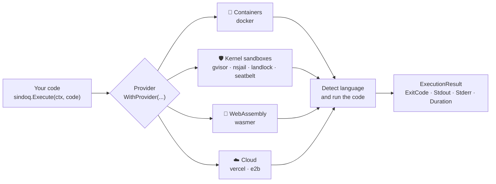

<div align="center">

<pre>
       _         __
  ___ (_)__  ___/ /__  ___ _
 (_-&lt;/ / _ \/ _  / _ \/ _ `/
/___/_/_//_/\_,_/\___/\_, /
                       /_/
</pre>

### AI Sandbox - One API, anywhere.

Run untrusted code in containers, kernel sandboxes, WebAssembly or the cloud<br/>with the same Go API. *sindoq* means "box" in Kurdish.

[](https://github.com/HappyHackingSpace/sindoq/actions/workflows/ci.yml)
[](https://pkg.go.dev/github.com/happyhackingspace/sindoq)
[](https://github.com/HappyHackingSpace/sindoq/releases)
[](LICENSE)

[Installation](#installation) · [Quick Start](#quick-start) · [Providers](#providers) · [Languages](#supported-languages) · [CLI](#cli-usage) · [API Reference](#api-reference)

</div>

---

```go
result, err := sindoq.Execute(ctx, `print("Hello from a sandbox!")`)
fmt.Println(result.Stdout) // Hello from a sandbox!
```

## Why sindoq?

| 🔁 One API | 🧭 Zero setup per language | 🛡️ Choose your isolation |
|---|---|---|
| The same `Execute` call works on Docker, gVisor, WebAssembly or a cloud sandbox. Switch with `WithProvider("…")`. | The language is detected from the code and mapped to the right runtime and image. | From containers to kernel sandboxes and microVMs, pick the trade-off between speed and isolation. |

## How it works



## Features

- 🔌 **Multi-provider support**: Docker, Podman, Wasmer, nsjail, gVisor, Firecracker, Landlock, Seatbelt, Kubernetes, Vercel, E2B
- 🧭 **Auto language detection**: Automatically detects programming language from code
- 📡 **Streaming output**: Real-time stdout/stderr streaming
- ⚡ **Async execution**: Non-blocking execution with channels
- 📏 **Resource limits**: Control CPU, memory, and execution time
- 📁 **File system access**: Read/write files in sandbox environments
- 🔔 **Events**: Subscribe to sandbox and execution events

## Installation

```bash
go get github.com/happyhackingspace/sindoq
```

Requires Go 1.26 or newer. Each provider also needs its own backend, such as a running Docker daemon, the `nsjail` or `wasmer` binary, or an API token for cloud providers. See [Providers](#providers).

## Quick Start

### One-liner Execution

```go
package main

import (
	"context"
	"fmt"
	"log"

	"github.com/happyhackingspace/sindoq"
)

func main() {
	ctx := context.Background()

	result, err := sindoq.Execute(ctx, `print("Hello, World!")`)
	if err != nil {
		log.Fatal(err)
	}
	fmt.Println(result.Stdout) // Hello, World!
}
```

The language is detected from the code, and the `docker` provider is used unless you pick another one.

### With Specific Provider

```go
sb, err := sindoq.Create(ctx, sindoq.WithProvider("docker"))
if err != nil {
    log.Fatal(err)
}
defer sb.Stop(ctx)

result, err := sb.Execute(ctx, `console.log("Hello")`, sindoq.WithLanguage("JavaScript"))
fmt.Println(result.Stdout)
```

### Streaming Output

```go
sb, err := sindoq.Create(ctx, sindoq.WithProvider("docker"))
defer sb.Stop(ctx)

err = sb.ExecuteStream(ctx, code, func(e *executor.StreamEvent) error {
    if e.Type == executor.StreamStdout {
        fmt.Print(e.Data)
    }
    return nil
})
```

### Async Execution

```go
results, err := sb.ExecuteAsync(ctx, code)

// Do other work...

result := <-results
fmt.Println(result.Stdout)
```

## Providers

| | Provider | Isolation | Linux | macOS | Windows | Status |
|:--:|----------|-----------|:-----:|:-----:|:-------:|--------|
| 🐳 | `docker` | Containers | ✅ | ✅ | ✅ | ✅ Implemented |
| 🦭 | `podman` | Rootless containers | ✅ | ✅ | ✅ | ❌ Not implemented yet ([#3](https://github.com/HappyHackingSpace/sindoq/issues/3)) |
| 🛡️ | `gvisor` | gVisor user-space kernel | ✅ | — | — | ✅ Implemented, untested ([#8](https://github.com/HappyHackingSpace/sindoq/issues/8)) |
| 🔒 | `nsjail` | Namespaces and seccomp | ✅ | — | — | ✅ Implemented, untested ([#8](https://github.com/HappyHackingSpace/sindoq/issues/8)) |
| 🧱 | `landlock` | Landlock LSM (kernel 5.13+) | ✅ | — | — | ✅ Implemented |
| 🍎 | `seatbelt` | `sandbox-exec` profiles | — | ✅ | — | ✅ Implemented |
| 🧩 | `wasmer` | WebAssembly | ✅ | ✅ | ✅ | ✅ Implemented (Python, JavaScript, Lua, Ruby, PHP, Shell) |
| 🔥 | `firecracker` | microVMs (KVM) | ✅ | — | — | ⚠️ Experimental ([#8](https://github.com/HappyHackingSpace/sindoq/issues/8)) |
| ▲ | `vercel` | Cloud sandbox | ✅ | ✅ | ✅ | ❌ Out of date with the Vercel API ([#5](https://github.com/HappyHackingSpace/sindoq/issues/5)) |
| 🧪 | `e2b` | Cloud sandbox | ✅ | ✅ | ✅ | ❌ Out of date with the E2B API ([#6](https://github.com/HappyHackingSpace/sindoq/issues/6)) |
| ☸️ | `kubernetes` | Pods | ✅ | ✅ | ✅ | ❌ Not implemented yet ([#4](https://github.com/HappyHackingSpace/sindoq/issues/4)) |

The platform columns show where the provider is compiled into sindoq. Each provider also needs its own backend (a Docker daemon, the `nsjail` binary, an API token, ...).

### Provider Configuration

```go
// Docker
sb, _ := sindoq.Create(ctx, sindoq.WithDockerConfig(sindoq.DockerConfig{
    Host: "unix:///var/run/docker.sock",
}))

// Vercel
sb, _ := sindoq.Create(ctx, sindoq.WithVercelConfig(sindoq.VercelConfig{
    Token: os.Getenv("VERCEL_TOKEN"),
}))

// E2B
sb, _ := sindoq.Create(ctx, sindoq.WithE2BConfig(sindoq.E2BConfig{
    APIKey: os.Getenv("E2B_API_KEY"),
}))

// Wasmer (cross-platform)
sb, _ := sindoq.Create(ctx, sindoq.WithWasmerConfig(sindoq.WasmerConfig{
    WasmerPath: "wasmer",
    TimeLimit:  30,
}))

// Seatbelt (macOS)
sb, _ := sindoq.Create(ctx, sindoq.WithSeatbeltConfig(sindoq.SeatbeltConfig{
    EnableNetwork: false,
}))

// Landlock (Linux 5.13+)
sb, _ := sindoq.Create(ctx, sindoq.WithLandlockConfig(sindoq.LandlockConfig{
    BestEffort: true,
}))
```

## Configuration Options

### Sandbox Options

```go
sb, _ := sindoq.Create(ctx,
    sindoq.WithProvider("docker"),
    sindoq.WithRuntime("Python"),
    sindoq.WithTimeout(5*time.Minute),
    sindoq.WithResources(sindoq.ResourceConfig{
        MemoryMB: 512,
        CPUs:     2,
        DiskMB:   1024,
    }),
    sindoq.WithInternetAccess(),
)
```

### Execution Options

```go
result, _ := sb.Execute(ctx, code,
    sindoq.WithLanguage("Python"),
    sindoq.WithExecutionTimeout(30*time.Second),
    sindoq.WithEnv(map[string]string{"DEBUG": "true"}),
    sindoq.WithStdin("input data"),
    sindoq.WithWorkDir("/app"),
)
```

## Supported Languages

21 languages, detected automatically from the code (or set with `WithLanguage`).

<details>
<summary>Language, runtime and Docker image table</summary>

| Language | Runtime | Docker Image |
|----------|---------|--------------|
| Python | python3 | python:3.12-slim |
| JavaScript | node | node:22-slim |
| TypeScript | ts-node (via npx) | node:22-slim |
| Go | go run | golang:1.25-alpine |
| Rust | rustc | rust:1.75-slim |
| Java | javac + java | eclipse-temurin:21-jdk |
| C | gcc | gcc:14 |
| C++ | g++ | gcc:14 |
| Ruby | ruby | ruby:3.3-slim |
| PHP | php | php:8.3-cli |
| Shell | bash | bash:5 |
| R | Rscript | r-base:4.3.2 |
| Kotlin | kotlin | zenika/kotlin:1.9 |
| Swift | swift | swift:5.9 |
| Scala | scala | sbtscala/scala-sbt:eclipse-temurin-21.0.1_12_1.9.7_3.3.1 |
| Perl | perl | perl:5.38 |
| Lua | lua | nickblah/lua:5.4 |
| Haskell | runhaskell | haskell:9.4 |
| Elixir | elixir | elixir:1.16 |
| Clojure | clojure | clojure:tools-deps |
| SQL | sqlite3 | keinos/sqlite3:latest |

</details>

The table mirrors `pkg/langdetect/runtime.go`. Known issue: Java compiles with `javac` and then runs `java` without a class name, so Java programs currently print the `java` usage text and exit with code 1.

## CLI Usage

```bash
# Install CLI
go install github.com/happyhackingspace/sindoq/cmd/sindoq@latest

# Execute code
sindoq 'print("Hello")'

# Specify language
sindoq -lang javascript 'console.log("Hi")'

# Execute from file
sindoq -file script.py

# Stream output
sindoq -stream 'for i in range(10): print(i)'

# Set a timeout (default 5m)
sindoq -timeout 30s 'print("Hello")'

# JSON output
sindoq -json 'print("Hello")'

# Use different provider
sindoq -provider vercel 'print("Hello")'

# Use Wasmer (works on Linux, macOS, Windows)
sindoq -provider wasmer 'print("Hello from WASM!")'
sindoq -provider wasmer -lang javascript 'console.log("Hello from QuickJS!")'

# Use Seatbelt (macOS native sandboxing)
sindoq -provider seatbelt 'print("Hello from Seatbelt!")'

# Use Landlock (Linux native sandboxing, kernel 5.13+)
sindoq -provider landlock 'print("Hello from Landlock!")'

# Pipe input
echo 'puts "Hello"' | sindoq -lang ruby

# Detect language only
sindoq -detect 'fn main() { println!("Hello"); }'

# List supported languages
sindoq -list-languages

# Show version
sindoq -version
```

## API Reference

### Sandbox Interface

```go
type Sandbox interface {
    ID() string
    Provider() string
    Execute(ctx context.Context, code string, opts ...ExecuteOption) (*executor.ExecutionResult, error)
    ExecuteAsync(ctx context.Context, code string, opts ...ExecuteOption) (<-chan *executor.ExecutionResult, error)
    ExecuteStream(ctx context.Context, code string, handler executor.StreamHandler, opts ...ExecuteOption) error
    RunCommand(ctx context.Context, cmd string, args ...string) (*executor.CommandResult, error)
    Files() fs.FileSystem
    Network() provider.Network
    Subscribe(eventType event.EventType, handler event.EventHandler) (unsubscribe func())
    Stop(ctx context.Context) error
    Status(ctx context.Context) (provider.InstanceStatus, error)
}
```

Types come from `pkg/executor`, `pkg/fs` and `pkg/event`. `provider.Network` and `provider.InstanceStatus` live in an internal package: you can call these methods, but you can't name the types in your own code.

### ExecutionResult

```go
type ExecutionResult struct {
    ExitCode  int
    Stdout    string
    Stderr    string
    Duration  time.Duration
    Language  string
    Artifacts []Artifact
    Error     error
    Metadata  map[string]any
}
```

## Use Cases

| | Use case | |
|:--:|----------|---|
| 🤖 | **Coding agents** | Execute AI-generated code, run terminal commands, access the filesystem |
| 📊 | **AI data analysis** | Explore datasets and generate visualizations safely |
| 💬 | **Code interpreters** | Build ChatGPT-like code execution for your AI assistant |
| 🔬 | **Deep research agents** | Long-running analysis on large datasets with streaming results |
| ⚙️ | **Automation agents** | Workflow automation with real code execution |
| 🧑‍💻 | **Interview platforms** | Run candidate code safely with resource limits |
| 🎓 | **Education and grading** | Auto-grade student submissions in isolated environments |

## Environment Variables

| Variable | Description |
|----------|-------------|
| `VERCEL_TOKEN` | Vercel API token (read by the CLI) |
| `E2B_API_KEY` | E2B API key (read by the CLI) |
| `WASMER_CACHE_DIR` | Wasmer cache directory (default: `$TMPDIR/wasmer-cache`) |

## Contributing

See [CONTRIBUTING.md](CONTRIBUTING.md) for guidelines.

## License

[MIT](LICENSE)

---

<p align="center">
  Made with ♥ by <a href="https://github.com/HappyHackingSpace">Happy Hacking Space</a>
</p>
